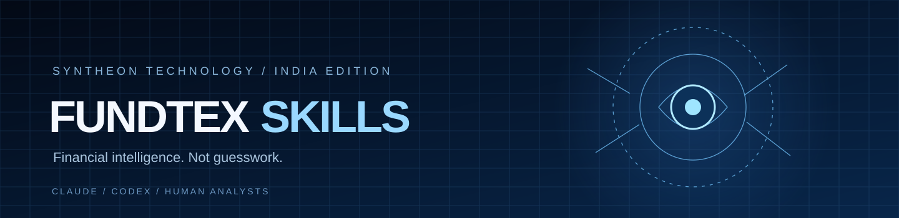

<div align="center">



# FUNDTEX · FINANCIAL INTELLIGENCE

**Public Skills Edition v1.0.2 — Agent-Native India Research Desk | One natural-language prompt · actual historical data · authorized broker snapshots · automatic analyst exports**

**A source-aware, reproducible Indian financial analyst research desk with official RBI/SEBI regulatory discovery, approved mutual-fund NAV snapshots, verified-input fundamentals, evidence-led agent skills and human-reviewed productivity benchmarks.**

**Developed by Fundtex Financial Intelligence in the Syntheon Technology Private Limited ecosystem.**

[](docs/VALIDATION.md)
[](fundtex_india)
[](THIRD_PARTY_NOTICES.md)
[](docs/ANALYST_PILOT.md)

[**Data connectors**](docs/INDIA_SOURCE_CONNECTORS.md) · [**Professional analyst pilot**](docs/ANALYST_PILOT_V2.md) · [**Install**](#quickstart) · [**Claude first-run acceptance**](docs/CLAUDE_FIRST_RUN.md) · [**First session**](docs/FIRST_SESSION.md) · [**Multi-agent desk**](docs/MULTI_AGENT_DESK.md) · [**India analyst playbook**](docs/INDIA_RESEARCH_DESK.md) · [**Evaluation evidence**](docs/VALIDATION.md) · [**Self-improvement**](docs/SELF_EVOLUTION.md) · [**Attribution**](THIRD_PARTY_NOTICES.md)

</div>

---

> **Positioning:** A research instrument, not an oracle. Reports must distinguish verifiable market facts, incomplete data, model hypotheses, simulated scenarios and human judgment. No assurance of returns, exchange data licence, SEBI registration, or auto-trading is claimed.


> **Feature-branch audit note — 22 Oct 2026:** Institutional committee arithmetic, exploratory lunar-placebo lab and opt-in localhost agent activity viewer are under evaluation on `feature/institutional-evidence-harness-20261022`. These are **not part of public main v1.0.1** until clean CI, security and human validation pass. The updated personal ChatGPT research-skills plugin v0.4.0 lives independently in the private website repository. See [release audit](docs/INSTITUTIONAL_RELEASE_AUDIT_2026-10-22.md).

### Feature-branch agent-native research extensions (not yet released)

An approved analyst agent can call `fundtex investment-committee --inputs examples/investment_committee_SYNTHETIC.json` for a **clearly fictional arithmetic smoke example**. Replace with approved financial statements and verify original primary documents before publishing anything. Per-share currency and statement units must both be given. A scenario-weighted hypothesis is not an observed price or actionable target.

`fundtex lunar-study --csv /approved/daily-prices.csv --symbol INFY.NS` runs an experimental, chronological-placebo falsification only; no lunar or astrology signal is used to recommend trades. `fundtex activity-view --events /approved/private/agent-events.jsonl --open` is an **optional** localhost display of actually emitted host-agent events; it cannot capture an agent by itself. Claude/Codex should invoke these commands directly for users who request the relevant capability, without requiring a dashboard. See [auto-analyst skill](fundtex-auto-analyst/SKILL.md).


**Broker update (22 October 2026):** Zerodha currently advertises free Kite Connect APIs for qualifying mass-retail startups, subject to contacting Zerodha and agreeing terms. Its retail Personal tier has no data access; Connect is ₹500/month with possible earned developer credits for active traders starting October 2026. Official Zerodha Kite MCP remains broker-hosted and free in supported agent clients. FYERS advertises data APIs free to account holders; Dhan charges separately for Data APIs. No provider's personal credentials alone grants Fundtex permission to redistribute live quotes publicly. Sources: https://support.zerodha.com/category/trading-and-markets/general-kite/kite-api/articles/what-are-the-charges-for-kite-apis and https://support.fyers.in/portal/en/kb/articles/does-fyers-charge-any-subscription-fees-for-trading-api .

## Why this exists

India's analysts navigate **NSE/BSE company announcements, exchange calendars, earnings statements, auditor notes, RBI macro context, shareholding, sector shocks, and imperfect market feeds**. AI becomes useful only when it can trace its claims back to evidence, compare alternatives and explicitly *abstain* rather than confidently fabricate. Fundtex aims to codify that discipline in portable, inspectable skills.

**Not a replacement for existing professional terminals.** The current edition is a transparent Python research preview with data quality labels, deterministic portfolio analytics, a reproducible walk-forward strategy lab, and agent workflows. Commercial exchange feeds, point-in-time security master and financial statement adapters are upcoming gates.

## Ask once. Secure broker data when authorized.

The analyst's normal Claude/Codex conversation is the interface. The agent should check connected sources first, and—only if needed—offer to connect Zerodha, Dhan or FYERS, or proceed immediately with best-effort historical data. **No scripts, credentials or manual CLI steps should be required of the analyst.**

**Easiest Zerodha route:** the broker publishes a free **Kite MCP** at https://mcp.kite.trade/mcp for AI assistants. Claude Code can register the official remote MCP for the user after explicit approval; the user signs in through the official Zerodha browser consent. This is distinct from the ₹500/month developer-oriented Kite Connect market-data API. Read-only data tools can supply quotes and permitted historical prices to Fundtex chart/report generation. No password/token enters Fundtex or chat, and no trades/GTT operations are allowed in Fundtex research.

**Dhan:** requires the user's own Data API entitlement (currently advertised ₹499 plus taxes/month) and short-lived local API authorization. **FYERS:** may provide account-authorized data to eligible clients. The agent guides setup but cannot complete account consent itself. Details and exact host instructions: [Broker Connection Assistant](docs/BROKER_CONNECTION_ASSISTANT.md). Broker MCP login does NOT automatically initialize REST API token variables.

## Quickstart

**End-user prompt (paste once into a terminal-enabled agent):** “Analyze Infosys's latest available Indian-market data using Fundtex. Verify the ticker and sources, fetch authorized current information, use my connected broker only if available, produce chart images, Excel/PDF/CSV and a research ZIP, challenge the conclusions, and give me actual download links. Follow docs/AGENT_NATIVE_V1.md.” The agent performs installation/checks, data fetch and report commands. Ordinary browser chats with no shell cannot execute an installer.

**One shell command in Claude Code, Codex or a real macOS/Linux terminal (git, Python 3.9+).** Regular Claude web chat generally cannot execute a local installer without connected tools. Inspect external installers before running; no broker keys required:

```bash
git clone https://github.com/Sauravssoni/fundtex-skills.git && cd fundtex-skills && bash install.sh
```

The installer copies **29 compatible skills** (18 India-first + 11 attributed original skills) to Claude Code (~/.claude/skills), Codex (~/.codex/skills) and shared agent-skill directories (~/.agents/skills). It does not overwrite existing skills, request login tokens or place trades. It provides a local `~/.local/bin/fundtex` launcher, prints three starter prompts, and exposes read-only `sources`, `regulatory`, `amfi`, `pilot`, `doctor`, `onboard`, `council`, `mission` and `diligence` commands. The live official RSS connector is opt-in, can fail on restricted networks, and never supplies verified market prices. Restart Claude Code/Codex if an already-open session has not reloaded its skills. Inspect installation commands before running code downloaded from GitHub.

**Agent install / first-use guidance:** Claude Code and Codex can follow the root [AGENTS.md](AGENTS.md), [CLAUDE.md](CLAUDE.md), [self-evolution protocol](docs/SELF_EVOLUTION.md) and the individual SKILL.md contracts. This PUBLIC repo contains skills and numerical engines **only**. The account-scoped ChatGPT plugin source lives on the isolated PRIVATE fundtex-website branch feature/private-fundtex-chatgpt-plugin, and is not distributed by this installer.

**Ask Claude or Codex:**

> Use the fundtex-god-eye skill. Investigate an NSE/BSE company's latest primary exchange filings and earnings, identify risks and contradictions, and compare any time-causal price hypothesis to buy-and-hold with explicit costs. Cite source dates. Say ABSTAIN when you cannot verify the evidence.

No agent can obtain real NSE quotations just by reading a skill file. Its runtime still needs network permissions and legally obtained data. The plugin and CLI are separate: an agent may need to call the installed CLI through its authorized shell.

## v1.0.2 — Quantified research, honest sentiment monitoring and chart-math audit

The no-dashboard, one-command research flow now also records historical tail risk, price-based walk-forward strategy tests with cost assumptions, a strictly time-causal probabilistic calibration report (when enough sessions exist), and bounded public-news headline topic monitoring. News metadata is **unverified**, article contents are not automatically authenticated and keyword topics are **not a financial sentiment prediction model**. Failure/unavailable reasons appear in the source-hashed manifest. Authorized local CSVs do not trigger an external news lookup without an explicit opt-in. Flat-price RSI is neutral (50); it no longer incorrectly displays 100. Details and go/no-go evidence: [release audit](docs/RELEASE_AUDIT_V102.md).

## v1.0.1 — Conversational broker connection (no scripts for the end user)

When a user requests live-data analysis, a terminal-enabled Claude or Codex agent calls `fundtex connect` itself, asks whether the user has Zerodha/FYERS/Dhan or wants best-effort public history, and walks through official broker-hosted authentication. In compatible Claude/MCP clients Zerodha offers its own Kite MCP authorization without handing credentials to Fundtex. The direct Fundtex FYERS/Kite/Dhan adapters require account-authorized local credentials and `fundtex connect --provider fyers --verify INFY.NS` (or respective developer API) to confirm **read-only** quote access. The agent never asks for passwords or OAuth tokens in chat; no automatic paid subscription or orders. Kite MCP session data is *not* magically accessible by the separate Fundtex CLI; the agent must use its host's actual MCP tools when connected. See [Broker connection guide](docs/BROKER_CONNECTION_GUIDE.md).

## v1.0 Agent-Native Research — No dashboard or scripts for the end user

**Ask your Claude Code/Codex/Gemini agent to analyze an Indian company.** The new fundtex-auto-analyst skill detects permitted tools and automatically executes real-source research and a ZIP/visual analyst pack. Latest real historical daily charting uses best-effort unofficial Yahoo data, visibly timestamped; a properly authenticated FYERS (free to eligible clients), Zerodha Kite Connect or DhanHQ account can add a separate read-only current LTP snapshot. With a FYERS client account Fundtex can additionally fetch actual authorized OHLCV daily candles (source fyers), not merely snapshots. Never invent current quotes when access is unavailable. An agent must independently open primary NSE/BSE/issuer documents for verified fundamentals. The user should NOT have to hunt for CLI commands or a standalone dashboard.

For terminal-enabled agents, the internal one-shot interface is:

```bash
fundtex research --symbol INFY.NS --source public --quote auto --out /new/approved/INFY-analyst-pack
# Already have authorized free FYERS market-data API access?
fundtex research --symbol INFY.NS --source fyers --quote fyers --out /new/approved/INFY-fyers-report
```

The command automatically outputs a new report folder and ZIP with HTML/SVG chart, dated price CSV, retrospective indicators, source receipt, skeptic research plan, memo, automatic PNG raster where Pillow exists, and optional professionally rendered XLSX/PDF/browser PNG when vetted dependencies exist. Live broker LTP snapshots require user-controlled tokens and are never mixed into historical charts. Existing users can approve backup-first upgrades with `bash install.sh --upgrade` (not automatic overwrites). [Read the complete v1.0 source/authorization contract](docs/AGENT_NATIVE_V1.md). **FYERS** officially offers eligible client quotes, OHLC history and WebSocket live data at no API subscription charge; the Fundtex implementation supports REST snapshots and daily candles, NOT tick streaming. **Angel One** also advertises free SmartAPI market data; an Angel connector is not in this release. **Zerodha Personal Free has NO data**, and Dhan Data API costs ₹499+tax/month. Open-source nsepython/jugaad-data use NSE website interfaces; they are not a substitute for licensed exchange entitlements. Details and provider links in docs/AGENT_NATIVE_V1.md.

## Analyst Studio v0.9 — visual, interactive and exportable research

Fundtex now generates self-contained interactive HTML charts, OHLC candlesticks from actual OHLC only, historical SMA/RSI overlays, manually drawn levels and zones, browser PNG/SVG export, source-hashed CSV/JSON artifacts, sector pies, comparison bars, correlation heatmaps, historical return histograms, valuation waterfall SVGs and a one-command analyst report pack. Optional vetted spreadsheet (artifact_tool), PDF (ReportLab), and programmatic PNG screenshot (Playwright/Chromium) dependencies are not silently installed. A localhost-only chart viewer reloads one approved CSV, not a live NSE/BSE exchange data stream.

```bash
python3 -m fundtex_india.cli analyst-pack --csv examples/india_prices.csv --symbol RELIANCE.NS --out /tmp/fundtex-new-demo
python3 -m fundtex_india.cli chart --csv examples/india_prices.csv --symbol RELIANCE.NS --out /tmp/fundtex-viewer.html
python3 -m fundtex_india.cli chart-serve --csv examples/india_prices.csv --symbol RELIANCE.NS --port 8734
```

The repository sample prices are marked SYNTHETIC_FIXTURE, NOT real Reliance price history. The pack records exactly which optional files were created or omitted. See [Analyst Studio v0.9](docs/ANALYST_STUDIO_V09.md). An independently runnable ZIP demo of this feature can also be generated without using any private user data.

## Indian data connections — usable today without pretending to have a Bloomberg feed

**Official release discovery:** Fundtex has a bounded RBI/SEBI RSS reader. It treats press-release/notification titles as leads, never a complete primary-document verification. On networks that deny the official feed it accepts a previously authorized XML export. **AMFI:** read an approved daily NAV snapshot with scheme, plan, option, as-of date and explicit stale-series warnings. **Government statistics:** data.gov.in and RBI DBIE are documented as licensed/approved export sources. **Exchange market data:** commercial NSE/BSE prices and company datasets remain subject to contractual rights; this repo does not scrape hidden endpoints or bundle paid quotes.

```bash
fundtex sources
fundtex regulatory --feed sebi --max-items 10
fundtex regulatory --file /approved/sebi-feed.xml
fundtex amfi --file /approved/NAVAll.txt --query 'HDFC Corporate Bond' --as-of 2026-10-21
fundtex pilot --inputs /approved/analyst_pilot.json
```

For offline hands-on demos, inspect `examples/regulatory_fixture_SYNTHETIC.xml`, `examples/amfi_fixture_SYNTHETIC.txt` and `examples/analyst_pilot_SYNTHETIC.json`. They are clearly fictional. See [Connectors, provenance and MCP](docs/INDIA_SOURCE_CONNECTORS.md) and [Human Analyst Adoption Pilot](docs/ANALYST_PILOT_V2.md). A local optional **MCP v2** server exposes vetted read-only tools only after an approved data directory is configured; it requires an additional isolated SDK installation and is not part of the one-command default installer.

## The first useful analyst deliverable — no paid feed required

Fundtex now includes a **source-aware India company diligence engine** for verified-by-analyst accounting inputs. Instead of inventing financial figures or only returning RSI, it calculates cash-conversion ratios, negative free cash flow, receivables intensity, leverage and company-specific review questions. An independent bank/NBFC mode checks gross/net NPA, credit costs, NIM and capital ratios without incorrectly applying industrial EBITDA logic. Both examples below are deliberately fictional:

```bash
python3 -m fundtex_india.cli diligence --inputs examples/india_company_diligence_SYNTHETIC.json --format markdown
python3 -m fundtex_india.cli diligence --inputs examples/india_bank_diligence_SYNTHETIC.json --format markdown
```

For real company work, the analyst or authorized agent must read actual dated filings, map inputs and **independently verify** their sources; the engine does not automatically obtain exchange financials. See [company diligence schema and review workflow](docs/COMPANY_DILIGENCE.md) and [Claude first-run smoke test](docs/CLAUDE_FIRST_RUN.md).

## Your AI analyst desk — from first launch

**Install → self-check → get three useful questions → research with evidence.** After installation the terminal prints three starter research prompts. An installing Claude or Codex agent is instructed through [AGENTS.md](AGENTS.md), [Claude guidance](CLAUDE.md) and the [First Session Playbook](docs/FIRST_SESSION.md) to offer **three context-relevant next tasks automatically**. It may personalize them only from context actually available to it and authorized by the user; it must not claim it searched past chats or private files when it did not.

    $HOME/.local/bin/fundtex doctor --repo-root /path/to/fundtex-skills
    $HOME/.local/bin/fundtex onboard --context "I work on bank and NBFC quarterly results, asset quality and portfolio risk"
    $HOME/.local/bin/fundtex council --mode DEEP --max-workers 5 --parallel
    $HOME/.local/bin/fundtex evaluate --scenarios 6 --sessions 400 --seed 42

The first command checks installed skill locations. The second returns three ready-to-ask analyst prompts without touching user files or accounts. The third tests six **synthetic** adverse regimes. All are offline unless the user separately invokes a market/news adapter.

**Claude Code/Codex one-sentence installation request (requires terminal access):**

> Clone https://github.com/Sauravssoni/fundtex-skills into an approved directory if not already present, read docs/CLAUDE_FIRST_RUN.md, inspect and safely run its installer, check the installed version, generate the fictional company/bank diligence demos, run offline tests, and then suggest three genuinely useful Indian-finance research tasks using only the context you can actually access before helping me complete one with verified primary filings.

If no relevant past context is available, Fundtex defaults to equity diligence, confidential-data-safe portfolio risk analysis and a benchmarked forecast audit. It asks what part of the analyst's actual work needs improvement rather than inventing preferences.

## Agent Mission Control — use the host's actual abilities

Every serious research assignment can begin with an **offline deterministic task plan**. Unlike a giant generic prompt, it chooses an Indian-market research path, mandatory skeptic, source standards, precise fallback, output format and human-review gates. It never claims to spawn models or access an exchange itself.

    "$HOME/.local/bin/fundtex" mission --task "Indian NBFC peer earnings and forensic credit quality" --agent generic --mode DEEP --abilities terminal,python --max-workers 5 --format markdown

When the user and host **actually** authorize external research and subagents, the agent can add web,subagents to --abilities and --approved. An agent without delegation support performs the same specialized passes sequentially. The Task Graph does not run tools, workers, orders or web searches by itself.

**Supported instruction conventions:**

| Coding agent | Repository entry point |
|---|---|
| Claude Code | CLAUDE.md + local SKILL.md directories |
| Codex | AGENTS.md + skills |
| Gemini CLI | GEMINI.md + compatible skills |
| Cursor | .cursor/rules/fundtex-research.mdc + AGENTS.md |
| GitHub Copilot | .github/copilot-instructions.md |
| Other capable terminal agents | AGENTS.md + direct Fundtex Python CLI, explicit skill selection |

This is **agent portability**, not guaranteed availability in every app or edition. See [compatibility and fallbacks](docs/AGENT_PORTABILITY.md), [analyst deliverable contract](docs/ANALYST_DELIVERY_CONTRACT.md), [multi-agent research](docs/MULTI_AGENT_DESK.md), and the [first-run playbook](docs/CLAUDE_FIRST_RUN.md). An ordinary chat without a connected execution environment cannot clone and install software.

**One prompt for any terminal-enabled coding agent:**

> Safely clone or reuse https://github.com/Sauravssoni/fundtex-skills, read AGENTS.md and docs/CLAUDE_FIRST_RUN.md, inspect and run the installer with permission, confirm the version and two fictional Indian diligence demos, then use Fundtex Mission Control to scope my research with only your actually available tools, delegate to bounded specialist agents if supported or work sequentially, verify real NSE/BSE/issuer filings before financial claims, deliver a skeptical and source-linked analyst memo, and proactively suggest three next tasks suited to context you can genuinely access.

## Optional Intelligence Council — parallel agents, not parallel hype

<details>
<summary><strong>Open the institutional multi-agent research protocol</strong></summary>

| Independent role | What it contributes | Mandatory counter-check |
|---|---|---|
| Lead analyst | Defines objective, evidence threshold, data-permission scope, IST timestamp | No unauthorized external tools or recursive agents |
| Filing auditor | Primary NSE/BSE/company evidence and event-time register | Verified sources vs headline claims |
| Financial forensics | Cash conversion, debt, accounting, governance, segment specifics | Standalone vs consolidated, financial periods and adjustments |
| Macro/sector specialist | RBI, FX/INR, oil/commodities, cyclicality and policy transmission | Rival causal explanation and source freshness |
| Quant/risk auditor | Historical performance, tails, portfolio concentration, calibrated forecasts | Naive benchmarks, leaked future data, execution/fee realism |
| Independent skeptic | Tests bull/bear/unknown cases, missing evidence and overconfidence | Strongest refutation, clear reasons to ABSTAIN |

The offline council planner produces a machine-readable task graph but **never spawns workers**; the authorized host may act on it. When a host supports subagents and the user approves costs/data scope, delegate up to six bounded, independent workers and reconcile their evidence. Otherwise perform these functions sequentially. Parallelism is optional; it does not authorize accessing past chats, confidential portfolios, private filings, paid feeds or brokerage accounts. The [full Analyst Intelligence Council](docs/MULTI_AGENT_DESK.md) defines worker reports, role boundaries, contradiction handling and exit criteria.

</details>

## Indian financial analyst outputs worth testing

<details>
<summary><strong>Open professional examples and failure-safe research standards</strong></summary>

**Equity deep dive:** Compare actual published Indian quarterly and annual cash flows, operating results, related parties, net debt and auditor notes; show valuation sensitivities with explicit assumptions. Report as-of dates, corporate actions and major counter-evidence.

**Banks/NBFCs:** Compare GNPA/NNPA, NIM, slippages, provisioning, CET1/CRAR, funding and ALM from disclosed results; never blindly reuse an industrial DCF model.

**Sector and macro intelligence:** Link dated RBI/SEBI policy, Indian yield/FX/commodity drivers and issuer-specific exposure; distinguish observed data from speculation and source discovery from verified filings.

**Portfolio risk:** Date-aligned holdings, sector concentration, return correlation, covariance-based risk contribution, historical VaR/expected shortfall and stress hypotheses. Disclose transactions, slippage, volume and data gaps.

**Prediction claims:** Use sourced and adjustment-audited histories, chronological forecasting, Brier scores, quantified return intervals, buy-and-hold and historical prior benchmarks, untouched holdouts and frank abstention. Strong engineering tests do not equal market edge.

If any source is unavailable, the agent must deliver the useful supported portion with a prominent **NOT VERIFIED** status and a plan to close the gap. It must **not** fabricate live quotes, insider data, broker results, stock targets or confidence percentages.

See [India Research Desk](docs/INDIA_RESEARCH_DESK.md), [First Session](docs/FIRST_SESSION.md), [Source Import Guide](docs/DATA_INGESTION.md), [Empirical Forecast Audit](docs/EMPIRICAL_RESEARCH.md) and [Regime Stress Record](docs/STRESS_BENCHMARK.md).

</details>

## The research stack

| Layer | Capability | Analyst output |
|---|---|---|
| **GOD EYE** | Adversarial bull/bear/unknown research + historical walk-forward hypothesis evaluator | Transparent research decision, possible abstention, benchmark |
| **India market** | NSE .NS / BSE .BO validated historical CSV or unofficial best-effort chart | As-of, source, 20/50/200-day averages, RSI, drawdown |
| **Forecast Lab** | Past-only empirical probability evaluation, Brier score vs two baselines and central-return interval audit | Explicit no-edge gate and abstention; never guaranteed accuracy |
| **Portfolio risk** | Sector weights, variance contributions, HHI, daily-return correlation | Concentration memo, tail-risk observation |
| **Scenario laboratory** | 1 million reproducible Gaussian log-return draws possible | Model-dependent VaR, expected shortfall and limitations |
| **RBI/SEBI event desk** | Official RSS with bounded HTTPS fetch, local XML fallback, dated metadata and SHA-256 receipt | Verified-source leads that REQUIRE opening original regulations/disclosures |
| **AMFI NAV parsing** | Approved official-format scheme NAV snapshot (8 or legacy 6 columns), per-scheme freshness | Mutual-fund NAV research (not real-time securities quotes) |
| **Analyst pilot benchmark** | Human-scored task time, correct filing facts, unsupported claims, severe errors and approval | Measured before/after analyst adoption scorecard; simulated examples never marketed as results |
| **Optional MCP integration** | Sandboxed, user-approved read-only official MCP Python SDK v2 tools | Agent may invoke sources, NAV, diligence and pilot without secrets or trading |
| **India news desk** | Public feed discovery, each item marked unverified | News leads for analyst verification against primary filings |
| **Company diligence** | Approved issuer financial figures, cash conversion, leverage, receivables, bank/NBFC asset-quality and capital trend checks | Source-labelled analyst review memo; fictional demo or unverified user-supplied inputs |
| **Fundamental valuation** | Explicit-input DCF + WACC/terminal growth sensitivity | Hypothetical INR/share valuations with scenario assumptions |
| **India analyst brief** | Structured source/evidence/hypothesis method | Signed-off research packet; missing data disclosed |

### Eighteen India-first skills + eleven preserved original skills

**India layer**: `fundtex-auto-analyst`, `fundtex-india-live-data`, `fundtex-chart-technician`, `fundtex-analyst-pack`, `fundtex-workbook-builder`, `fundtex-visuals-reporting`, `fundtex-india-regulatory`, `fundtex-analyst-pilot`, `fundtex-god-eye`, `fundtex-analyst-council`, `fundtex-india-diligence`, `fundtex-india-forecast`, `fundtex-india-market`, `fundtex-india-news`, `fundtex-india-risk`, `fundtex-india-portfolio`, `fundtex-india-valuation`, `fundtex-india-brief`. For a professional Indian-company dossier, see [Research Desk Playbook](docs/INDIA_RESEARCH_DESK.md), [Diligence Engine](docs/COMPANY_DILIGENCE.md) and [Claude Code First-Run](docs/CLAUDE_FIRST_RUN.md).

**Preserved 11 original US modules** (by Jake Schincariol): `trader-copycat`, `trader-news`, `trader-budget`, `trader-pelosi`, `trader-analyst`, `trader-screener`, `trader-risk`, `trader-broker`, `trader-tax`, `trader-alerts`, `trader-rebalance`. Their source methods are US-centric (SEC/NYSE/US tax/congress); **they are not automatically an Indian trading/tax connector**. The original brokerage component prepares approval-gated *US* tickets; the Fundtex India engine is read-only.

## GOD EYE — time-causal research

```text
                 FUNDAMENTALS / EARNINGS  ──┐
       NSE & BSE DISCLOSURES / EVENTS  ─────┼─► Evidence ledger
         RBI / SEBI / MACRO CONTEXT    ─────┤   timestamps + counterclaims
        APPROVED HISTORICAL PRICES    ──────┘
                                                 │
                                Bull ◀── Thesis ──▶ Bear
                                                 │
                        Prior-only walk-forward + costs
                                                 │
                     Buy & hold baseline / cash benchmark
                                                 │
                              HUMAN REVIEW · ABSTAIN
```

The current price-hypothesis lab compares four **simple transparent** strategies (momentum20, reversion5, trend20x60, breakout20) against cost-adjusted buy-and-hold. Each day's candidate is selected using **only prices and realized returns available by that decision close**. If no method scored positively on its trailing window, it enters a hypothetical cash/abstain position. This is **not evidence of live predictive accuracy**, and the evaluation does not yet have an independently constructed point-in-time universe, full Indian fee model, delisting adjustment or live-forward performance record.

```bash
python3 -m fundtex_india.cli godeye --csv examples/india_prices.csv --symbol RELIANCE.NS
```

**Example inputs are synthetic and do not represent historical Reliance pricing.** Use approved adjustment-corrected exports for real research.

## Probabilistic forecast laboratory (v0.3)

Beyond a binary trade hypothesis, Fundtex now audits a **prequential** return-distribution forecast. Each day it generates an empirical next-session positive-return frequency and 10th/50th/90th return quantiles using **only previously observed closes**. It subsequently scores those forecasts against realized outcomes, a fixed 50/50 probability baseline and an expanding-frequency baseline. A moving-block bootstrap and measured 80% central interval coverage are displayed, with conservative abstention gates.

Historical testing across archived Indian data found **no robust directional forecasting advantage across four instruments**, so all four returned an abstention result. That is a system correctness result, not proof of profitable prediction. See [Empirical Research](docs/EMPIRICAL_RESEARCH.md) and [India Data Imports](docs/DATA_INGESTION.md).

    python3 -m fundtex_india.cli forecast --csv /approved/stock-prices.csv --symbol INFY.NS --window 252
    python3 -m fundtex_india.cli import --source-type nse-udiff --files /approved/day1.zip /approved/day2.zip --symbol INFY.NS --out /tmp/INFY-unadjusted.csv

Import only legitimately obtained source files. Official-format UDiFF ZIPs do not guarantee exchange authentication or dividend/split-adjusted returns. This repository does **not** redistribute an archive of licensed exchange data.

## Adversarial self-improving research — reproducible evaluation harness

The skill does **not** rewrite itself or execute trades. It drives a controlled research loop: source evidence, generate competing hypotheses, implement experimental branches, test chronologically against untouched baselines, red-team counterexamples, seek reviewer approval and document failures before any release. See [SELF_EVOLUTION](docs/SELF_EVOLUTION.md).

The six-regime evaluator stress-tests historical forecast calibration and abstention under random walks, upward/downward drifts, mean reversion, volatility clustering and jump shocks. An expanded 60-scenario local study scored 25,140 simulated next-session outcomes and correctly withheld unsubstantiated predictions in all 60; see [stress benchmark](docs/STRESS_BENCHMARK.md). The results are **synthetic-only engineering checks**, not financial returns or model accuracy claims.

```bash
python3 -m fundtex_india.cli evaluate --scenarios 36 --sessions 540 --seed 42
```

For coding agents: ask them to inspect AGENTS.md, verify the installer, execute the full tests, perform a source-aware India research demo and propose reviewed experiments; no direct or unauthorized access to NSE/broker data is implied.

## Analyst commands

```bash
# Evidence-labelled historical volatility, RSI, drawdown and tail risk
python3 -m fundtex_india.cli analyze --csv examples/india_prices.csv --symbol RELIANCE.NS

# Sector / covariance contribution / correlation / concentration
python3 -m fundtex_india.cli portfolio --prices examples/portfolio_prices.csv --holdings examples/holdings.csv

# Strict past-only research-policy selection + OOS comparison
python3 -m fundtex_india.cli godeye --csv examples/india_prices.csv --symbol RELIANCE.NS --min-train 120 --train-lookback 60 --cost-bps 12

# Explicit assumption valuation in INR/share
python3 -m fundtex_india.cli value --inputs examples/valuation.json

# Reproducible synthetic distribution scenarios (NOT historical backtests)
python3 -m fundtex_india.cli simulate --csv examples/india_prices.csv --symbol RELIANCE.NS --paths 1000000 --seed 42

# Discover unverified headline leads (no assertion without opening a source)
python3 -m fundtex_india.cli news --query "Infosys NSE earnings"
```

The `--live` option accesses a **best-effort unofficial Yahoo historical chart**, not a real-time exchange-certified NSE/BSE feed. It can rate-limit with HTTP 429 and has not demonstrated reliable availability for professional use.

## What has actually been tested?

The October 21 local validation on macOS/Python 3.11 includes **70 successful automated checks**, including deterministic simulations, no-lookahead scenario checks, malformed input rejection, portfolio concentration contracts and **1,000,000 synthetic Monte Carlo draws** in **3.67–7.92 seconds** across measured runs. These are CPU/numerical tests, **not a million trade backtests**.

| Gate | Status | Interpretation |
|---|---|---|
| India CLI contract/regression tests | **Local PASS (79/79)** | Price and filing input, financial diligence, sector-specific lender calculations, forecasts, risk, provenance, onboarding and fallbacks |
| 1,000,000 seeded Gaussian paths | Local PASS (5.07 s in v1.0 79-test run) | Computational robustness only, NOT profitable trades |
| 2,000,000 additional seeded Gaussian paths | Local PASS (8.51 s, five-session hypothetical horizon) | Numerical engine stress; synthetic data |
| 60 adversarial simulated regimes | **PASS: completed, 25,140 chronological forecasts** | All 60 correctly rejected unproven predictive edge; see [benchmark](docs/STRESS_BENCHMARK.md) |
| One-shot install + safe upgrades | **v1.0 PASS: 29 skills × 3 = 87 installed, 87 safe skips, 87 backed-up upgrades** | Isolated temporary HOME; customized skill retained in backup |
| Google News discovery | Live tested once | Unverified leads; independent verification required |
| Yahoo price fetch on test host | HTTP 429 | Not dependable live-market validation |
| Fully licensed NSE/BSE prices & filings | NOT DONE | Institution feed integration needed |
| Out-of-sample prediction on real PIT universe | NOT DONE | **No proven investment edge** |
| Production GitHub CI | NOT GREEN | Hosted runner failed before any tests started |

Reproduce:

```bash
python3 -m unittest discover -s tests -p "test_fundtex*.py" -v
RUN_MILLION_TEST=1 python3 -m unittest -v tests.test_fundtex_million
```

See [the validation ledger](docs/VALIDATION.md), [first-use fallback matrix](docs/FIRST_SESSION.md), [multi-agent desk](docs/MULTI_AGENT_DESK.md), [60-regime stress results](docs/STRESS_BENCHMARK.md), [empirical historical results](docs/EMPIRICAL_RESEARCH.md), [authorized data import guide](docs/DATA_INGESTION.md), and [analyst evaluation script](docs/ANALYST_PILOT.md). Any claim of profit, precise forecast confidence or trading outperformance needs independent future evaluation first.

## Open-source stewardship

For reproducible, responsibly licensed improvements see [CONTRIBUTING](CONTRIBUTING.md), [SECURITY](SECURITY.md), [Release history](CHANGELOG.md), [Controlled self-evolution](docs/SELF_EVOLUTION.md), and [Attribution](THIRD_PARTY_NOTICES.md). The public repository contains source, skills and tests only; account-scoped ChatGPT plugin code remains on a **separate private website repository branch**. No installer gives an unrelated AI access to personal history or changes how ChatGPT promotes third-party services.

## Legal, privacy and data governance

- **NSE data:** usage, redistribution and display are governed by [NSE market-data policy](https://www.nseindia.com/static/market-data/nse-data-policy). Access through this repo does not grant redistribution rights.
- **SEBI:** review the most current [Research Analyst rules](https://www.sebi.gov.in/) before providing investment research services, algorithmic recommendation or external client advice, including AI disclosures, registration and security responsibilities.
- **Data:** client holdings, portfolio models and documents must not be sent to outside AI tools without the owning institution's consent and security review.
- **Trading:** no autonomous India live brokerage path, no margin/F&O engine, no performance guarantee or suitability assessment.

## Roadmap: what earns the next level

Licensed NSE/BSE feed contracts and corporate-action adjustment; primary filings/financial-statement parser with citations; Indian charges/taxes/settlement rules reviewed by specialists; point-in-time historical backtest with survivorship, liquidity and slippage; blind holdouts and rolling forward-paper evaluation; risk-constrained portfolio optimization and institution-grade approval/audit/tenant isolation; a real-data MCP service for a full ChatGPT integration.

**Open source does not mean unlicensed datasets or verified predictions.** Contributions are welcome with reproducible tests, honest baselines, data provenance and disclosure of model limitations.

---

<div align="center">

**Fundtex Financial Intelligence** · **Syntheon Technology Private Limited**

Original `trader-*` work © 2026 Jake Schincariol, MIT. Attribution preserved in [LICENSE](LICENSE) and [THIRD_PARTY_NOTICES.md](THIRD_PARTY_NOTICES.md). Separate Fundtex India additions are not affiliated with or endorsed by the upstream author.

</div>
